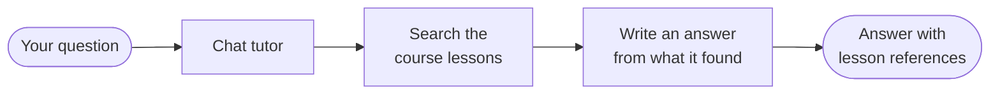

<div align="center">


# AI Programming

### Learn to build software with AI.

A public course site for beginners. Follow the lessons, ask the AI tutor when you are stuck, and finish with a project of your own.

<a href="https://programming.chanmeng.org/"></a> <a href="https://programming.chanmeng.org/capstone-showcase/"></a> <a href="https://programming.chanmeng.org/blog"></a>

</div>

<br>

<a href="https://programming.chanmeng.org/"></a>

<br>

https://github.com/user-attachments/assets/33c14478-a4a4-458b-a176-6a7c7079bc1a

<details>
<summary><sub>The earlier platform walkthrough</sub></summary>

https://github.com/user-attachments/assets/7f452170-ee23-44ad-ac87-7ad41161cd3b

</details>

<br>

## Try it

Open **[programming.chanmeng.org](https://programming.chanmeng.org/)**. Nothing to install.

The site opens on the current course, TECHNEST 2026. It reads in English and 简体中文.

## Why learn here

- **Five courses, all open.** TECHNEST 2026, Peyvand Academy 2026, HER WAKA 2026, Summer 2025 and Winter 2024 stay online, so you can start from any of them.
- **A tutor that shows its sources.** Ask the chat tutor on any page. It answers from the course content and names the lessons it used.
- **It ends in something real.** The capstone showcase shows the projects the TECHNEST 2026 students built.



## For your agent

This page is all a person needs. Everything else is written for agents: clone the repo and point yours at [`CLAUDE.md`](CLAUDE.md). To run the site locally:

```bash
git clone https://github.com/ChanMeng666/ai-programming-teaching-project
cd ai-programming-teaching-project && npm install && npm start
```

<sub>[Full overview](.github/OVERVIEW.md) · [Design system](DESIGN.md) · [Capstone runbook](CAPSTONE_SHOWCASE.md) · [Changelog](CHANGELOG.md) · [Contributing](CONTRIBUTING.md) · [MIT](LICENSE)</sub>

<sub>Built by [Chan Meng](https://github.com/ChanMeng666).</sub>
